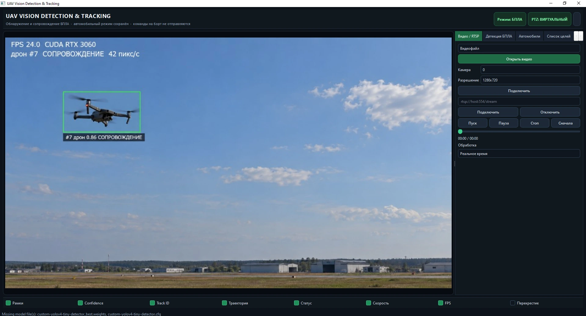
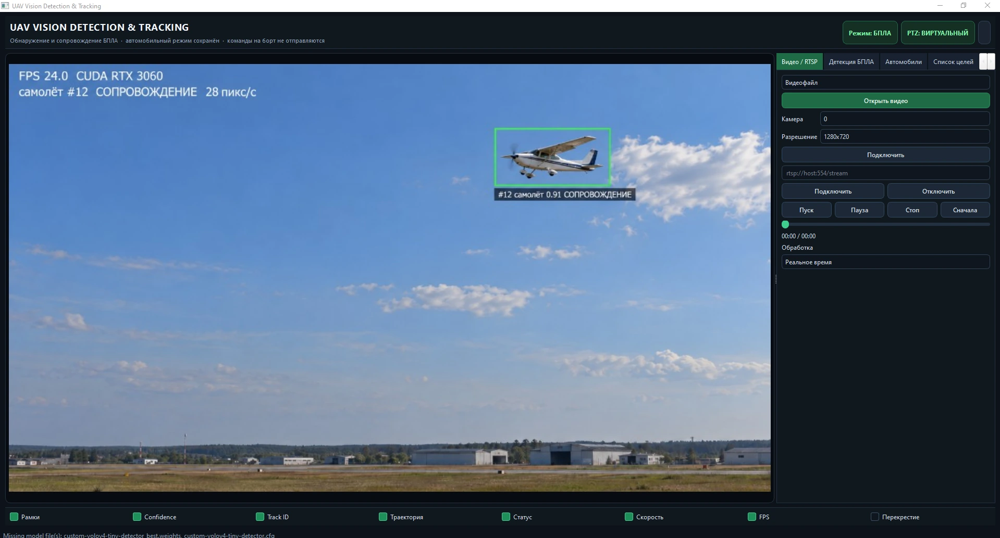
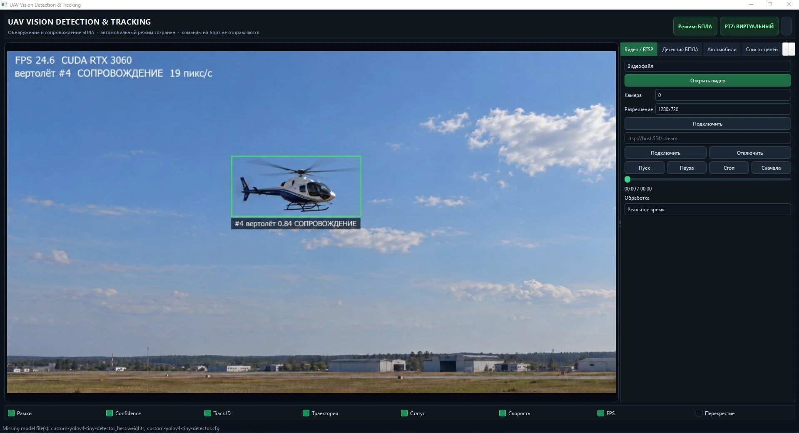

# UAV Vision Detection & Tracking

A local Windows computer-vision application for **detecting and tracking UAVs, aircraft and vehicles** from video files, webcams and RTSP streams. The project combines Ultralytics YOLOv8-compatible UAV detection, multi-object tracking, persistent track IDs, target-state analysis, virtual PTZ visualization, recording, event export and a retained vehicle-tracking mode based on the earlier FPV workflow.

The application is designed as an **observation and tracking system**. It does not send flight commands to an aircraft, does not convert image coordinates into GPS coordinates, and does not infer real-world range unless an explicit calibration is provided.

## Demonstration

### UAV tracking

The main application view shows a detected drone with class, confidence, persistent track ID, tracking state and screen-space speed.


### Aircraft tracking

The same pipeline can work with compatible model classes for aircraft / fixed-wing UAVs.



### Helicopter tracking

The interface also supports helicopter-class tracking when the selected model exposes a compatible class.



> The screenshots supplied with this repository are application demonstration frames. Detection quality and supported classes depend on the model weights selected by the user.

## Main capabilities

- local real-time video processing;
- video-file, webcam and RTSP input;
- YOLOv8 / Ultralytics `.pt` or `.onnx` detector support;
- UAV-oriented class filtering;
- vehicle mode retained from the earlier FPV tracking project;
- ByteTrack-style multi-object association;
- BoT-SORT-style tracking option implemented without ReID;
- persistent track IDs across short detection gaps;
- track states such as `DETECTED`, `TRACKING`, `OCCLUDED`, `LOST` and `REACQUIRED`;
- bounding boxes, confidence, track ID, trajectory, status and FPS overlays;
- screen-space target speed in pixels per second;
- optional calibrated speed conversion when a meters-per-pixel scale is supplied;
- virtual PTZ / camera-follow simulation;
- target list and target-selection workflow;
- video recording and screenshots;
- CSV export;
- JSONL event logging;
- UDP event output for external command-center integration;
- model library / weight selection;
- dataset import and YOLO training workflow;
- performance monitoring;
- English and Russian interface text;
- CPU / CUDA / AUTO device selection with fallback logic.

## Supported object classes

UAV mode accepts known UAV / airborne-object class names from the selected model, including:

- `drone`
- `quadcopter`
- `FPV drone`
- `fixed-wing UAV`
- `bird`
- `aircraft`
- `airplane` → normalized to `aircraft`
- `car`

A general-purpose COCO model is not presented as a dedicated UAV detector. For example, stock YOLO COCO weights do not contain a dedicated `drone` class.

## Detection pipeline

The UAV pipeline uses the public Ultralytics inference API with user-supplied compatible weights.

Typical processing flow:

```text
Video / Webcam / RTSP
        │
        ▼
Frame acquisition
        │
        ▼
YOLO detector
        │
        ▼
Class filtering + NMS
        │
        ▼
Multi-object tracker
        │
        ├── Track ID
        ├── State
        ├── Trajectory
        └── Screen-space speed
        │
        ▼
Renderer / target list / recorder / event export
```

The application does not automatically download a model when it starts. A compatible local `.pt` or `.onnx` file can be selected in the UI. Model catalog entries may be managed separately through the integrated model-library workflow.

## Tracking

The tracking subsystem maintains object identity beyond a single detector frame.

Implemented behavior includes:

- multi-object association;
- stable numerical track IDs;
- short-gap persistence when a detector temporarily misses an object;
- `OCCLUDED` state during temporary loss;
- `REACQUIRED` state after successful matching;
- trajectory history;
- target selection and target list;
- per-track screen-space velocity.

Two tracker choices are exposed in the UAV workflow:

### ByteTrack

Association based on detection confidence and motion / overlap logic, including lower-confidence candidates for maintaining an existing track.

### BoT-SORT-style mode

The included implementation combines Kalman-style prediction and IoU association. It does **not** include a person/vehicle ReID network, so it should not be described as full appearance-based BoT-SORT.

## Vehicle mode

The project retains the earlier vehicle-tracking mode for compatibility with the FPV workflow.

It supports:

- YOLOv4-tiny vehicle detection when compatible `.cfg` and `.weights` files are supplied;
- mouse target selection;
- automatic target selection;
- Original and Enhanced tracking modes;
- virtual guidance visualization;
- CSV output.

The public repository does not include third-party vehicle model weights from the referenced upstream research project.

## Video sources

### Video file

Open a local video file and process it frame by frame.

### Webcam

Select a local camera index and resolution.

### RTSP

Connect to a network camera / stream through an RTSP URL. Connection errors are handled without crashing the application.

## Virtual PTZ

The PTZ subsystem is a **software simulation** by default. It maintains bounded pan / tilt state and can visualize target-follow behavior without controlling physical hardware.

This makes it useful for testing tracking logic before integrating a real gimbal or camera head.

## Recording and export

The application can save:

- annotated video recordings;
- screenshots;
- CSV tracking / control data;
- JSON event snapshots;
- live JSONL event logs.

Runtime outputs are intentionally ignored by Git so generated media and logs do not pollute the repository.

## Command Center integration

Tracked objects can be converted to compact JSON events for integration with an external sensor-fusion / monitoring application.

A typical event contains:

```json
{
  "id": "uav-vision-01-7",
  "sensor_id": "uav-vision-01",
  "track_id": 7,
  "class": "drone",
  "confidence": 82.0,
  "cv": true,
  "bbox_norm": {"x": 0.1, "y": 0.2, "w": 0.05, "h": 0.08},
  "status": "TRACKING",
  "speed_px_s": 12.5
}
```

The event intentionally does **not** invent latitude, longitude, range or GPS data from a 2D image box.

See [`docs/COMMAND_CENTER.md`](docs/COMMAND_CENTER.md) for the event format and UDP/JSONL details.

## Model and training workflow

The application includes utilities for preparing a custom YOLO dataset and launching local Ultralytics training.

Supported workflow includes:

- importing images;
- importing video frames;
- importing YOLO-format labels;
- train / validation split;
- reading class names;
- launching local training from a base `.pt` model;
- reading real metrics from Ultralytics `results.csv`;
- basic video evaluation.

The software does not fabricate precision, recall or mAP values when training metrics are unavailable.

## Performance and GPU selection

The detector supports:

- `AUTO`
- `CUDA`
- `CPU`

The application checks the requested execution path and can fall back to CPU if CUDA is unavailable or inference fails.

Actual FPS depends on:

- model size;
- input resolution;
- GPU / CPU;
- video decoding;
- tracker choice;
- rendering options.

## Project structure

```text
UAV-Vision-Detection-Tracking/
├── main.py
├── install.bat
├── start.bat
├── requirements.txt
├── app/                 # PySide6 application and panels
├── capture/             # video, webcam and RTSP sources
├── detection/           # YOLOv8 + YOLOv4 detector backends
├── tracking/            # multi-object tracking and target state
├── control/             # virtual guidance / legacy vehicle logic
├── ptz/                 # virtual PTZ adapter
├── visualization/       # overlays, boxes, trajectories
├── recording/           # video recording
├── export/              # CSV export
├── integration/         # Command Center event adapter
├── training/            # dataset and evaluation helpers
├── simulation/          # demo scenarios
├── library/             # model library management
├── model/               # model metadata / local weight location
├── docs/                # documentation
├── tests/               # validation tests
└── tools/               # self-test and utility scripts
```

## Installation

### Requirements

- Windows 10 / Windows 11
- Python 3.10+
- optional NVIDIA GPU for compatible CUDA builds

### Automatic installation

Run:

```bat
install.bat
```

Then start the application with:

```bat
start.bat
```

### Python dependencies

Core requirements include:

- OpenCV
- NumPy
- PySide6
- Ultralytics

See [`requirements.txt`](requirements.txt) for the current package constraints.

## UAV model weights

Large trained UAV model weights are **not committed to this public repository**.

Place a compatible `.pt` or `.onnx` model in `model/` or select it from the application interface.

```text
model/
├── README.txt
├── catalog.json
├── classes.txt
└── your_uav_model.pt   # local file, ignored by Git
```

This keeps the source repository lightweight and avoids silently redistributing model files whose training data / licensing may differ from the application source license.

## Vehicle detector files

The legacy vehicle mode expects compatible YOLOv4-tiny files such as:

```text
model/custom-yolov4-tiny-detector_best.weights
model/custom-yolov4-tiny-detector.cfg
model/classes.txt
```

Those third-party model assets are not included in the public repository.

## Verification

The archive includes tests and helper tools such as:

```bat
python -m unittest tests.test_spec -v
python tools/verify_install.py
python tools/self_test.py
```

The implementation report supplied with this version documents tests for:

- missing weights behavior;
- UAV class filtering;
- CPU fallback;
- video input;
- RTSP failure handling;
- track persistence and reacquisition;
- calibrated / uncalibrated speed handling;
- JSON event generation;
- UDP / JSONL event output;
- train / validation dataset split;
- metric parsing;
- virtual PTZ limits;
- demo labeling.

See [`docs/IMPLEMENTATION_REPORT_RU.md`](docs/IMPLEMENTATION_REPORT_RU.md).

## Safety and scope

This repository is a computer-vision engineering tool for detection, tracking, recording and sensor-event integration.

It does not:

- control a real aircraft;
- provide weapon guidance;
- convert image coordinates into GPS coordinates;
- estimate true physical range without a calibrated source;
- claim that synthetic demo detections are outputs from a trained UAV model.

Virtual vehicle guidance and PTZ behavior are simulation / visualization features.

## Privacy

Processing is local. The application does not require a cloud computer-vision API for inference. Network access is only needed when the user explicitly opens an RTSP/network source, downloads a configured model asset, or sends events to a configured external receiver.

## License

The original application source code in this repository is released under the **Apache License 2.0**. See [`LICENSE`](LICENSE).

Third-party packages, models and external reference projects remain under their own licenses. See [`THIRD_PARTY_LICENSES.md`](THIRD_PARTY_LICENSES.md).

## Related documentation

- [`docs/USER_GUIDE_RU.md`](docs/USER_GUIDE_RU.md) — detailed Russian user guide
- [`docs/IMPLEMENTATION_REPORT_RU.md`](docs/IMPLEMENTATION_REPORT_RU.md) — implementation and validation report
- [`docs/COMMAND_CENTER.md`](docs/COMMAND_CENTER.md) — event-integration format
